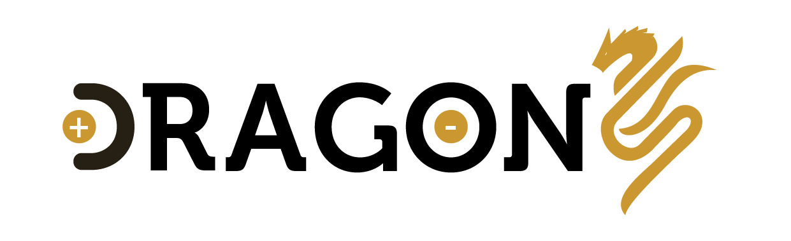

<p align="center">
  
</p>

<p align="center">
  <b>Open-Source Program for Diabatization of Multiple Excited States in Multiple Fragments</b>
</p>

<p align="center">
  <a href="LICENSE"></a>
  <!-- After the first Zenodo release, replace the line below with the DOI badge Zenodo gives you -->
  <!-- <a href="https://doi.org/10.5281/zenodo.XXXXXXX"></a> -->
</p>

DRAGON builds quasi-diabatic excited states from the adiabatic states computed with standard
quantum-chemistry packages, using the fragment particle–hole densities (FPHD) diabatization
scheme. For a system divided into any number of user-defined fragments, it gives:

- locally excited (LE) and charge-transfer (CT) diabatic states, and the diabatic Hamiltonian
  (diabatic energies and electronic couplings).
- the LE/CT character of every adiabatic and diabatic state.
- diabatic electric (length and velocity) and magnetic transition dipole moments.
- hole and particle density matrices of the diabatic states.
- the diabatic spin–orbit coupling matrix (ORCA calculations).

DRAGON is developed at the Instituto de Ciencias Moleculares (ICMol), Universitat de València.

## Supported programs

| Program | Excited-state methods (`TD`) | Unrestricted | SOC | Files read by DRAGON |
|---|---|:---:|:---:|---|
| Gaussian 16 | TD-DFT/TD-HF (`'TD'`), CIS/TDA (`'CIS'`) | ✓ | – | `.log`, `.fchk`, `.rwf` |
| ORCA 5 / 6 | TD-DFT (`'TD'`), CIS/TDA (`'CIS'`) | ✓ | ✓ (restricted) | `.out`, `.gbw`, `.cis` |
| PySCF | TD-DFT (`'TD'`), CIS/TDA (`'CIS'`) | ✓ | – | `.out`, `.npz` |
| Psi4 | TD-DFT (`'TD'`), CIS/TDA (`'CIS'`) | ✓ | – | `.out`, `.npz` |
| xTB + stda | sTDA (`'STDA'`) | – | – | `.out`, `MOS`, `ciss_a` |
| Gaussian 16 + stda | sTDA (`'STDA'`) | – | – | `.log`, `.fchk`, `.rwf`, `ciss_a` |

The [user manual](docs/DRAGON_manual.pdf) explains how to generate these files with each program.

## Requirements

- `gfortran`
- LAPACK and BLAS ≥ 3.7.0 (the default `Makefile` uses Intel MKL; OpenBLAS or reference LAPACK/BLAS also work)
- Python ≥ 3.6.12, callable as `python3`
- NumPy ≥ 1.19.4 and PyParsing ≥ 2.2.0

## Installation

```bash
git clone https://github.com/Pauarsan/DRAGON.git
cd DRAGON

# Python dependencies
python3 -m pip install --user "numpy>=1.19.4" "pyparsing>=2.2.0"

# Fortran core (load Intel MKL first, e.g. "source /opt/intel/oneapi/setvars.sh")
cd src
make
```

Without MKL, replace the `LIBFLAGS` line of `src/Makefile` by `LIBFLAGS=-llapack -lblas` (or `-lopenblas`).

Finally, add to your `~/.bashrc` the folder that contains `DRAGON.exe` and `Inter.py`:

```bash
export DRAGONPATH=/path/to/DRAGON/src
```

## Quick start

1. Run the excited-state calculation with one of the supported programs. The atoms of each
   fragment must be consecutive in the input geometry.
2. Generate the files listed in the table above. All of them share the same base name.
3. Write the DRAGON input. Example for a dimer of two  molecules computed with Gaussian 16
   (TDA, 6-31G\*):

```fortran
$DIAB
Inp='DDCP'  ! Base name of the files of the QM program.
Spin='R'             ! R: restricted. U: unrestricted.
Nstates=30           ! Number of adiabatic states to diabatize.
TD='CIS'             ! TD: TD-DFT. CIS: CIS/TDA-TDDFT. STDA: sTDA.
Nfrag=2              ! Number of fragments.
AI=3                 ! Number of different atom types.
Dip=.t.              ! Diabatic transition dipole moments (.t./.f.).
DenMat=.t.           ! Hole and particle density files (.t./.f.).
SOC=.f.              ! Diabatic SOC matrix (ORCA only) (.t./.f.).
$END

$FRAG
NAFrag=36,36         ! Number of atoms of each fragment.
AN=17,6,1            ! Atomic numbers of the atom types.
AB=19,15,2           ! Basis functions of each atom type (same order as AN).
$END
```

4. Run DRAGON in the folder that contains the input and the files of the QM program:

```bash
export OMP_NUM_THREADS=8
$DRAGONPATH/DRAGON.exe diab.inp > diab.out
```

Ready-to-run inputs for all the interfaced programs are in [`examples/`](examples/).

## Documentation

The [user manual](docs/DRAGON_manual.pdf) covers installation, the files needed from each
program (including the xTB modification), all input keywords, and the content of the output.

## Repository structure

```
DRAGON/
├── src/         Fortran core, Python interface (Inter.py) and Makefile
├── examples/    Input files of the examples (Gaussian 16, ORCA, PySCF, Psi4)
├── docs/        User manual and logo 
└── LICENSE
```

## How to cite

If you use DRAGON, please cite:

- P. Armada, J. Cerdá and J. Aragó, "DRAGON: Open-Source Program for Diabatization of Multiple
  Excited States in Multiple Fragments", *J. Chem. Theory Comput.* Submitted.

and the FPHD diabatization method:

- Y.C. Wang, S. Feng, W. Liang and Y. Zhao, *J. Phys. Chem. Lett.* **2021**, *12*, 1032–1039.
  DOI: [10.1021/acs.jpclett.0c03514](https://doi.org/10.1021/acs.jpclett.0c03514)
- Y.C. Wang, S. Feng, Y. Kong, X. Huang, W. Liang and Y. Zhao, *J. Chem. Theory Comput.* **2023**,
  *19*, 3900–3914. DOI: [10.1021/acs.jctc.3c00243](https://doi.org/10.1021/acs.jctc.3c00243)

Please also cite the quantum-chemistry program used to compute the excited states.

## License

DRAGON is free software distributed under the [GNU General Public License v3.0](LICENSE).

## Contact

Pau Armada ([pau.armada@uv.es](mailto:pau.armada@uv.es)),
Jesús Cerdá ([jesus.cerda@uv.es](mailto:jesus.cerda@uv.es)) and
Juan Aragó ([juan.arago@uv.es](mailto:juan.arago@uv.es)).
Instituto de Ciencias Moleculares (ICMol), Universitat de València, Spain.
